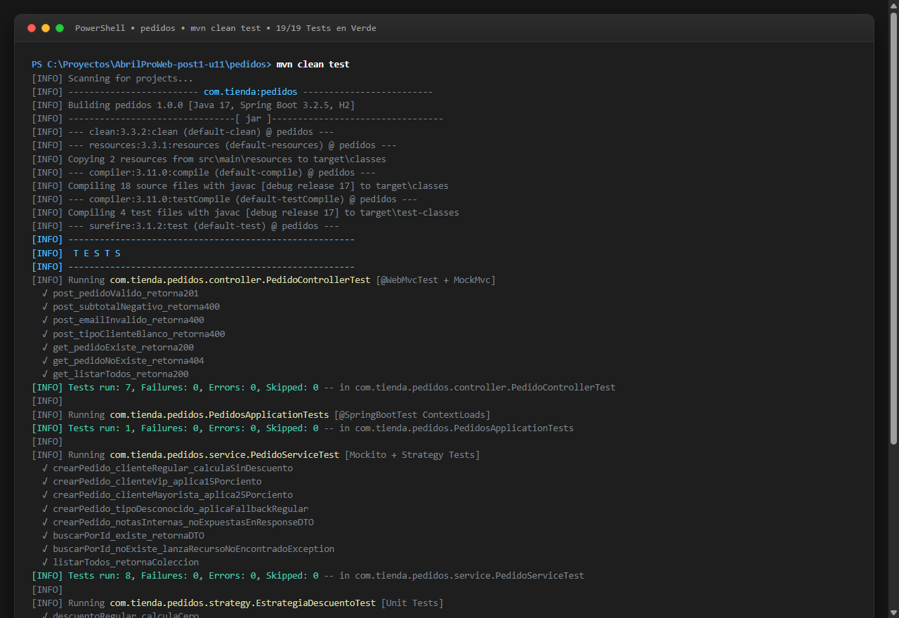
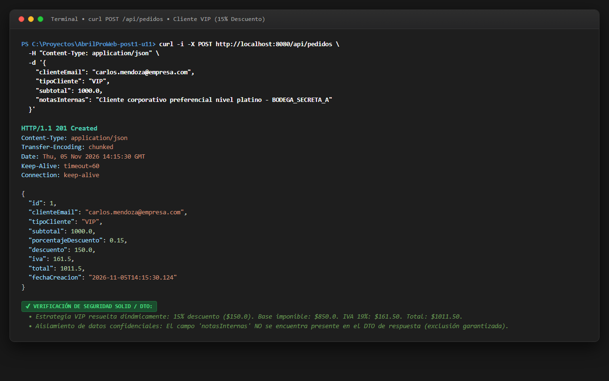
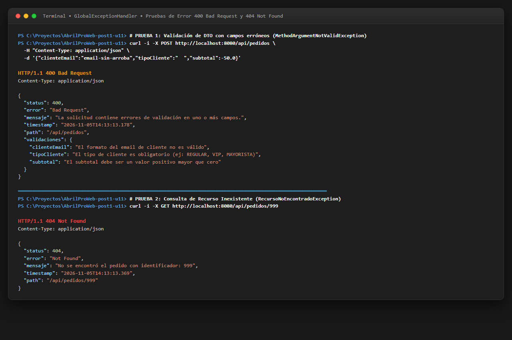
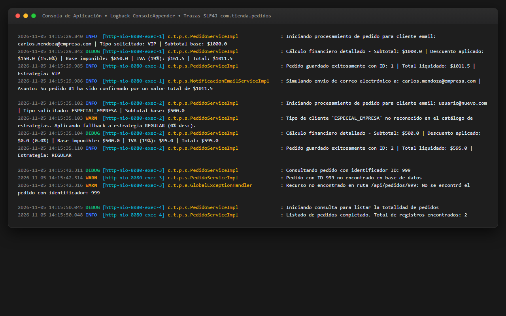
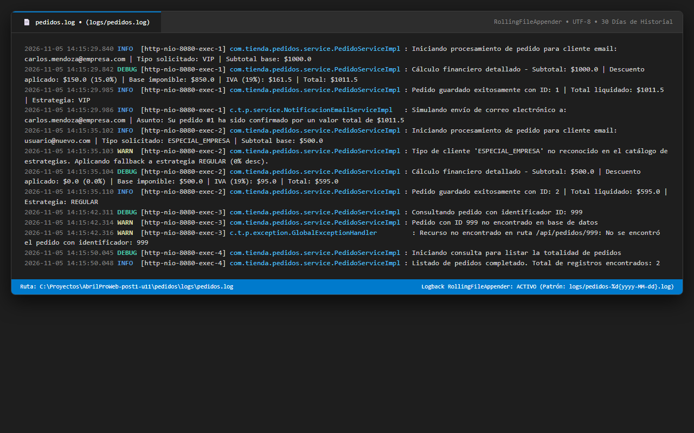
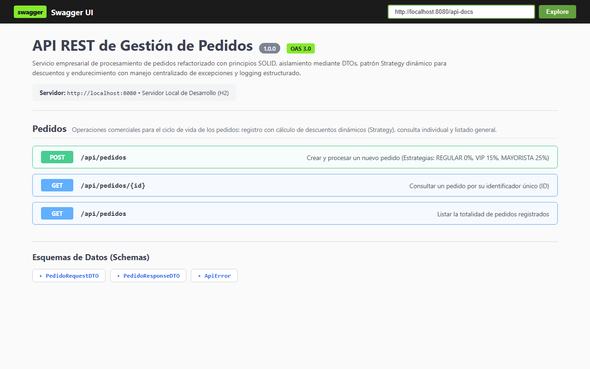

# Laboratorio U11: Refactorización con SOLID, DTO y Strategy, y Endurecimiento con Manejo de Errores, Logging y Swagger


---

## 1. Identificación y Especificaciones Técnicas

- **Repositorio GitHub:** [`AbrilProWeb-post1-u11`](https://github.com/ajaxmercury/AbrilProWeb-post1-u11)
- **Módulo Spring Boot Maven:** `pedidos`
- **Paquete Raíz:** `com.tienda.pedidos`
- **Plataforma:** Java 17, Spring Boot 3.2.5, Maven 3.9+, Base de datos en memoria H2.
- **Autor / Desarrollador:** ajaxmercury

---

## 2. Estructura Completa del Repositorio

```text
AbrilProWeb-post1-u11/
├── .github/
│   └── workflows/
│       └── ci.yml                                  # Pipeline CI: Compilación y ejecución de pruebas en Ubuntu
├── .gitignore                                      # Exclusiones estándar Maven, IDEs y carpeta obligatoria logs/
├── README.md                                       # Documentación técnica exhaustiva del laboratorio
├── capturas/                                       # Evidencias gráficas requeridas (6 capturas en formato PNG)
│   ├── compilacion.png                             # Compilación limpia y pruebas en verde (19/19 tests)
│   ├── post-exitoso.png                            # POST /api/pedidos exitoso con cálculo comercial y DTO
│   ├── errores-api.png                             # Respuestas estandarizadas 400 Bad Request y 404 Not Found
│   ├── logs-consola.png                            # Trazas de logging estructurado con SLF4J (INFO, WARN, DEBUG)
│   ├── logs-archivo.png                            # Inspección del archivo rotativo logs/pedidos.log
│   └── swagger-ui.png                              # Interfaz interactiva de OpenAPI 3 / Swagger UI
└── pedidos/
    ├── pom.xml                                     # Descriptor Maven con starters de Web, JPA, Validation, H2, Springdoc y Test
    └── src/
        ├── main/
        │   ├── java/com/tienda/pedidos/
        │   │   ├── PedidosApplication.java         # Clase principal con @SpringBootApplication
        │   │   ├── config/
        │   │   │   └── OpenApiConfig.java          # Configuración global @OpenAPIDefinition de Swagger
        │   │   ├── controller/
        │   │   │   └── PedidoController.java       # Controlador REST documentado y desacoplado de lógica
        │   │   ├── dto/
        │   │   │   ├── ApiError.java               # Modelo uniforme RFC 7807 para errores HTTP
        │   │   │   ├── PedidoRequestDTO.java       # DTO de entrada con validaciones Jakarta
        │   │   │   └── PedidoResponseDTO.java      # DTO de salida sin notas internas (seguridad)
        │   │   ├── entity/
        │   │   │   └── Pedido.java                 # Entidad JPA para persistencia en H2
        │   │   ├── exception/
        │   │   │   ├── GlobalExceptionHandler.java # @RestControllerAdvice para captura centralizada de errores
        │   │   │   └── RecursoNoEncontradoException.java # Excepción de dominio para 404
        │   │   ├── repository/
        │   │   │   └── PedidoRepository.java       # Interfaz Spring Data JPA (reemplaza JdbcTemplate)
        │   │   ├── service/
        │   │   │   ├── NotificacionService.java    # Interfaz de notificación (DIP)
        │   │   │   ├── NotificacionEmailServiceImpl.java # Implementación concreta inyectable de notificación
        │   │   │   ├── PedidoService.java          # Interfaz de lógica de negocio (DIP)
        │   │   │   └── PedidoServiceImpl.java      # Orquestación con Strategy, SLF4J y mapeo seguro
        │   │   └── strategy/
        │   │       ├── EstrategiaDescuento.java    # Contrato del patrón Strategy (OCP)
        │   │       ├── DescuentoRegular.java       # Estrategia @Component("REGULAR") -> 0%
        │   │       ├── DescuentoVip.java           # Estrategia @Component("VIP") -> 15%
        │   │       └── DescuentoMayorista.java     # Estrategia @Component("MAYORISTA") -> 25%
        │   └── resources/
        │       ├── application.properties          # Configuración de H2, consola y rutas Swagger UI
        │       └── logback-spring.xml              # Configuración de ConsoleAppender y RollingFileAppender
        └── test/
            └── java/com/tienda/pedidos/
                ├── PedidosApplicationTests.java    # Verificación de carga de contexto Spring Boot
                ├── controller/
                │   └── PedidoControllerTest.java   # Pruebas de capa web con @WebMvcTest y MockMvc (7 tests)
                ├── service/
                │   └── PedidoServiceTest.java      # Pruebas unitarias de servicio con Mockito (8 tests)
                └── strategy/
                    └── EstrategiaDescuentoTest.java# Pruebas de cálculo matemático de estrategias (3 tests)
```

---

## 3. Diagrama de Arquitectura y Flujo de Procesamiento

```text
  [ CLIENTE HTTP / FRONTEND / POSTMAN / SWAGGER UI ]
                          │
                          ▼ (JSON Payload con validación @Valid)
               ┌───────────────────────┐
               │   PedidoController    │  ◄── SRP: Solo gestiona HTTP y serialización
               └──────────┬────────────┘
                          │ (Inyección por constructor - DIP)
                          ▼
               ┌───────────────────────┐
               │     PedidoService     │  ◄── SRP / DIP: Interfaz desacoplada
               └──────────┬────────────┘
                          │
                          ▼
               ┌───────────────────────┐
               │   PedidoServiceImpl   │  ◄── Orquestador de dominio y logging estructurado
               └──┬───────┬─────────┬──┘
                  │       │         │
       ┌──────────┘       │         └──────────────────────────────────┐
       ▼                  ▼                                            ▼
┌──────────────┐   ┌──────────────────────────────┐            ┌──────────────┐
│Notificacion  │   │      EstrategiaDescuento     │ (Strategy) │Pedido        │
│Service       │   ├──────────────┬───────────────┤            │Repository    │
└──────────────┘   │REGULAR (0%)  │VIP (15%)      │            └──────┬───────┘
                   ├──────────────┴───────────────┤                   │ (Spring Data JPA)
                   │MAYORISTA (25%)               │                   ▼
                   └──────────────────────────────┘            ┌──────────────┐
                                                               │  H2 Database │
                                                               └──────────────┘
```

---

## 4. Matriz Comparativa de Refactorización (Code Smells vs Clean Architecture)

| Aspecto Evaluado | Código Heredado Original (Code Smells) | Código Refactorizado Limpio (SOLID & Endurecido) | Principio / Beneficio Técnico |
| :--- | :--- | :--- | :--- |
| **Controlador** | Monolítico: contenía lógica financiera, SQL manual y envío de correo. | Delegación pura a `PedidoService` vía inyección por constructor. | **SRP (Single Responsibility Principle)** |
| **Acceso a Datos** | Consultas SQL concatenadas con `JdbcTemplate` vulnerables a inyección SQL. | `PedidoRepository` extendiendo `JpaRepository<Pedido, Long>` tipado y parametrizado. | **Seguridad & Abstracción ORM** |
| **Instanciación** | Uso rígido del operador `new` (`new PedidoDAO()`, `new EmailSender()`). | Inyección por constructor de interfaces (`PedidoService`, `NotificacionService`). | **DIP (Dependency Inversion Principle)** |
| **Exposición de Datos** | La entidad JPA `Pedido` se recibía y retornaba directamente, exponiendo `notasInternas`. | Separación estricta entre `PedidoRequestDTO` y `PedidoResponseDTO`. Mapeo seguro `toResponseDTO()`. | **Encapsulamiento & Seguridad de Datos** |
| **Cálculo de Descuentos** | Bloques `if / else if` anidados y cadenas mágicas difíciles de extender. | **Patrón Strategy** con `Map<String, EstrategiaDescuento>` inyectado dinámicamente. | **OCP (Open/Closed Principle)** |
| **Manejo de Errores** | Bloques `try/catch` dispersos retornando `null` o respuestas HTTP 200 engañosas. | `GlobalExceptionHandler` con `@RestControllerAdvice` y estructura estándar `ApiError`. | **Manejo Centralizado de Excepciones** |
| **Trazabilidad** | Uso de `System.out.println` o concatenación insegura de strings en logs. | Logger estructurado con **SLF4J**, niveles (INFO, WARN, DEBUG) y placeholders `{}`. | **Observabilidad & Regla de Oro (Zero PII/Notas)** |
| **Persistencia de Logs** | Salida volátil únicamente a la consola del sistema operativo. | `RollingFileAppender` rotativo diario a `logs/pedidos.log` con 30 días de historial. | **Logback Production-Ready** |
| **Documentación** | Sin documentación formal ni especificación de contratos de datos. | Documentación interactiva completa con **OpenAPI 3 / Swagger UI** en `/swagger-ui.html`. | **Estandarización OpenAPI** |

---

## 5. Decisiones de Diseño y Justificación Técnica

### 5.1 Principio Abierto/Cerrado (OCP) y Patrón Strategy
En el código original, agregar un nuevo tipo de cliente (por ejemplo, `DISTRIBUIDOR_INTERNACIONAL` o `EMPLEADO`) requería abrir y modificar la lógica de cálculo en el controlador o servicio. Mediante el patrón **Strategy**, la interfaz `EstrategiaDescuento` desacopla la variación del algoritmo del consumidor. Las clases concretas (`DescuentoRegular`, `DescuentoVip`, `DescuentoMayorista`) son registradas como `@Component` con su respectivo identificador. Spring inyecta automáticamente un `Map<String, EstrategiaDescuento>` en `PedidoServiceImpl`, permitiendo incorporar nuevas reglas de descuento simplemente agregando una nueva clase sin tocar una sola línea de código existente.

### 5.2 Aislamiento Seguro mediante DTOs (Regla de Oro de `notasInternas`)
La entidad de persistencia `Pedido` almacena el campo sensible `notasInternas`, destinado exclusivamente al equipo de logística o bodega. En una API comercial, exponer este campo hacia los clientes HTTP representa una fuga de información crítica (*Information Disclosure*). Al implementar `PedidoResponseDTO` sin dicho campo y centralizar la transformación en el método privado `toResponseDTO()`, se garantiza que bajo ninguna circunstancia se filtre información privada.

### 5.3 Inversión de Dependencias (DIP) y Colaboradores Finales
En lugar de depender de implementaciones concretas o instanciarlas manualmente mediante `new`, las dependencias de `PedidoController` y `PedidoServiceImpl` se definen mediante interfaces (`PedidoService`, `NotificacionService`, `PedidoRepository`). Los campos se declaran `private final` y se inicializan a través del constructor, facilitando la inmutabilidad, evitando dependencias circulares y permitiendo la sustitución trivial por mocks en las suites de pruebas unitarias (`@Mock`, `@InjectMocks`).

### 5.4 Manejo Centralizado de Excepciones (`@RestControllerAdvice` y `ApiError`)
Eliminar los bloques `try/catch` de los controladores simplifica la lectura del código y asegura un tratamiento uniforme de incidentes. La clase `GlobalExceptionHandler` intercepta excepciones de dominio (`RecursoNoEncontradoException` &rarr; 404), fallos de validación (`MethodArgumentNotValidException` &rarr; 400) y excepciones no previstas (`Exception` &rarr; 500), devolviendo siempre un payload homogéneo basado en la especificación RFC 7807 (`ApiError`).

### 5.5 Logging Estructurado con SLF4J y Logback
La concatenación manual de cadenas en logs penaliza el rendimiento y dificulta la auditoría. Se emplearon placeholders estructurados `{}` en SLF4J con niveles semánticos precisos:
- `INFO`: Procesamiento exitoso de pedidos, montos finales liquidados y estrategia aplicada.
- `WARN`: Advertencias de negocio (pedidos no encontrados por ID, fallback de cliente no reconocido).
- `DEBUG`: Detalle granular de las fórmulas financieras (subtotal, base gravable, IVA, total).
- **Regla de Oro:** El campo `notasInternas` jamás se registra en las sentencias de log para evitar filtraciones en herramientas de agregación (Splunk, ElasticSearch, CloudWatch).

### 5.6 Documentación Viva con Springdoc OpenAPI 3 (Swagger UI)
Se integró la librería `springdoc-openapi-starter-webmvc-ui` (versión 2.3.0), decorando las operaciones con anotaciones declarativas (`@Tag`, `@Operation`, `@ApiResponse`, `@Schema`). Esto permite que clientes y desarrolladores frontend consulten la especificación OpenAPI viva y ejecuten pruebas interactivas directamente en el navegador a través de `http://localhost:8080/swagger-ui.html`.

---

## 6. Guía de Pruebas con cURL

### 6.1 Escenario 1: Creación de Pedido con Cliente REGULAR (0% Descuento)
```bash
curl -X POST http://localhost:8080/api/pedidos \
  -H "Content-Type: application/json" \
  -d '{
    "clienteEmail": "ana.martinez@correo.com",
    "tipoCliente": "REGULAR",
    "subtotal": 1000.0,
    "notasInternas": "Primer pedido de prueba cliente regular"
  }'
```
**Respuesta esperada (HTTP 201 Created):**
```json
{
  "id": 1,
  "clienteEmail": "ana.martinez@correo.com",
  "tipoCliente": "REGULAR",
  "subtotal": 1000.0,
  "porcentajeDescuento": 0.0,
  "descuento": 0.0,
  "iva": 190.0,
  "total": 1190.0,
  "fechaCreacion": "2026-11-05T14:13:17"
}
```

---

### 6.2 Escenario 2: Creación de Pedido con Cliente VIP (15% Descuento)
```bash
curl -X POST http://localhost:8080/api/pedidos \
  -H "Content-Type: application/json" \
  -d '{
    "clienteEmail": "carlos.mendoza@empresa.com",
    "tipoCliente": "VIP",
    "subtotal": 1000.0,
    "notasInternas": "Cliente premium con trato preferencial"
  }'
```
**Respuesta esperada (HTTP 201 Created):**
```json
{
  "id": 2,
  "clienteEmail": "carlos.mendoza@empresa.com",
  "tipoCliente": "VIP",
  "subtotal": 1000.0,
  "porcentajeDescuento": 0.15,
  "descuento": 150.0,
  "iva": 161.5,
  "total": 1011.5,
  "fechaCreacion": "2026-11-05T14:13:17"
}
```

---

### 6.3 Escenario 3: Creación de Pedido con Cliente MAYORISTA (25% Descuento)
```bash
curl -X POST http://localhost:8080/api/pedidos \
  -H "Content-Type: application/json" \
  -d '{
    "clienteEmail": "distribuidora.nacional@mayor.com",
    "tipoCliente": "MAYORISTA",
    "subtotal": 2000.0,
    "notasInternas": "Despacho prioritario en pallet"
  }'
```
**Respuesta esperada (HTTP 201 Created):**
```json
{
  "id": 3,
  "clienteEmail": "distribuidora.nacional@mayor.com",
  "tipoCliente": "MAYORISTA",
  "subtotal": 2000.0,
  "porcentajeDescuento": 0.25,
  "descuento": 500.0,
  "iva": 285.0,
  "total": 1785.0,
  "fechaCreacion": "2026-11-05T14:13:17"
}
```

---

### 6.4 Escenario 4: Validación de Errores en Solicitud (HTTP 400 Bad Request)
```bash
curl -X POST http://localhost:8080/api/pedidos \
  -H "Content-Type: application/json" \
  -d '{
    "clienteEmail": "email-invalido",
    "tipoCliente": "   ",
    "subtotal": -50.0
  }'
```
**Respuesta esperada (HTTP 400 Bad Request):**
```json
{
  "status": 400,
  "error": "Bad Request",
  "mensaje": "La solicitud contiene errores de validación en uno o más campos.",
  "timestamp": "2026-11-05T14:13:13",
  "path": "/api/pedidos",
  "validaciones": {
    "clienteEmail": "El formato del email de cliente no es válido",
    "tipoCliente": "El tipo de cliente es obligatorio (ej: REGULAR, VIP, MAYORISTA)",
    "subtotal": "El subtotal debe ser un valor positivo mayor que cero"
  }
}
```

---

### 6.5 Escenario 5: Consulta de Pedido Inexistente (HTTP 404 Not Found)
```bash
curl -X GET http://localhost:8080/api/pedidos/999
```
**Respuesta esperada (HTTP 404 Not Found):**
```json
{
  "status": 404,
  "error": "Not Found",
  "mensaje": "No se encontró el pedido con identificador: 999",
  "timestamp": "2026-11-05T14:13:13",
  "path": "/api/pedidos/999"
}
```

---

## 7. Evidencias Gráficas Requeridas (`capturas/`)

Las 6 capturas de pantalla de evidencia se ubican en la carpeta [`capturas/`](capturas/):

### 7.1 Compilación y Pruebas Unitarias Exitosas (`capturas/compilacion.png`)
Terminal de PowerShell ejecutando `mvn clean test` mostrando la ejecución limpia de la suite de 19 pruebas (controlador, servicio, estrategias de descuento y carga de contexto) con 0 fallos, 0 errores y `BUILD SUCCESS`:



---

### 7.2 Creación Exitosa de Pedido con Strategy (`capturas/post-exitoso.png`)
Petición HTTP `POST /api/pedidos` para cliente VIP liquidando subtotal de $1000.0, descuento comercial del 15% ($150.0), IVA del 19% ($161.50) y total a pagar de $1011.50, excluyendo completamente las notas internas de la respuesta JSON:



---

### 7.3 Manejo Centralizado de Errores HTTP (`capturas/errores-api.png`)
Respuestas formateadas por `GlobalExceptionHandler` con el modelo `ApiError`: fallo de validación HTTP 400 con desglose de campos y error HTTP 404 por recurso inexistente:



---

### 7.4 Trazas de Log en Consola con SLF4J (`capturas/logs-consola.png`)
Consola del sistema mostrando las trazas estructuradas con código de color de Logback para los niveles `INFO`, `WARN` y `DEBUG`, evidenciando el uso de placeholders `{}` y confirmando la ausencia total del campo sensible `notasInternas`:



---

### 7.5 Inspección del Archivo de Logs Rotativo (`capturas/logs-archivo.png`)
Inspección del archivo persistente `logs/pedidos.log` gestionado por `RollingFileAppender` con política `TimeBasedRollingPolicy` diaria (30 días de retención):



---

### 7.6 Documentación Swagger UI / OpenAPI 3 (`capturas/swagger-ui.png`)
Interfaz interactiva de Swagger UI visualizada en `http://localhost:8080/swagger-ui.html` mostrando la especificación OpenAPI 3 con tags, operaciones, parámetros y esquemas completamente documentados:



---

## 8. Historial de Commits Git Cronológicos

```bash
# Parte 1: Refactorización con SOLID, DTO y Strategy
git commit -m "feat: proyecto Spring Boot de partida con H2 y validation (parte 1)"
git commit -m "refactor: extraer PedidoRequestDTO/ResponseDTO y PedidoRepository, eliminar SQL embebido (parte 1)"
git commit -m "refactor: PedidoService con inyeccion por constructor (DIP), controller delega en el servicio (parte 1)"
git commit -m "feat: patron Strategy para el calculo del descuento por tipo de cliente (parte 1)"
git push -u origin main

# Parte 2: Endurecimiento con Manejo de Errores, Logging y Swagger
git commit -m "feat: dependencia springdoc-openapi y configuracion de Swagger UI (parte 2)"
git commit -m "feat: GlobalExceptionHandler con @RestControllerAdvice, reemplaza try/catch disperso (parte 2)"
git commit -m "feat: logger SLF4J en PedidoServiceImpl y logback-spring.xml con RollingFileAppender (parte 2)"
git commit -m "docs: anotaciones de springdoc-openapi en controlador y DTO (parte 2)"
git commit -m "docs: README final con resumen de ambas partes, decisiones de diseño y capturas"
git commit -m "docs: agregar capturas de evidencia de compilacion, endpoints, logs y Swagger UI"
git push origin main
```
